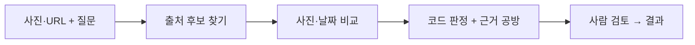
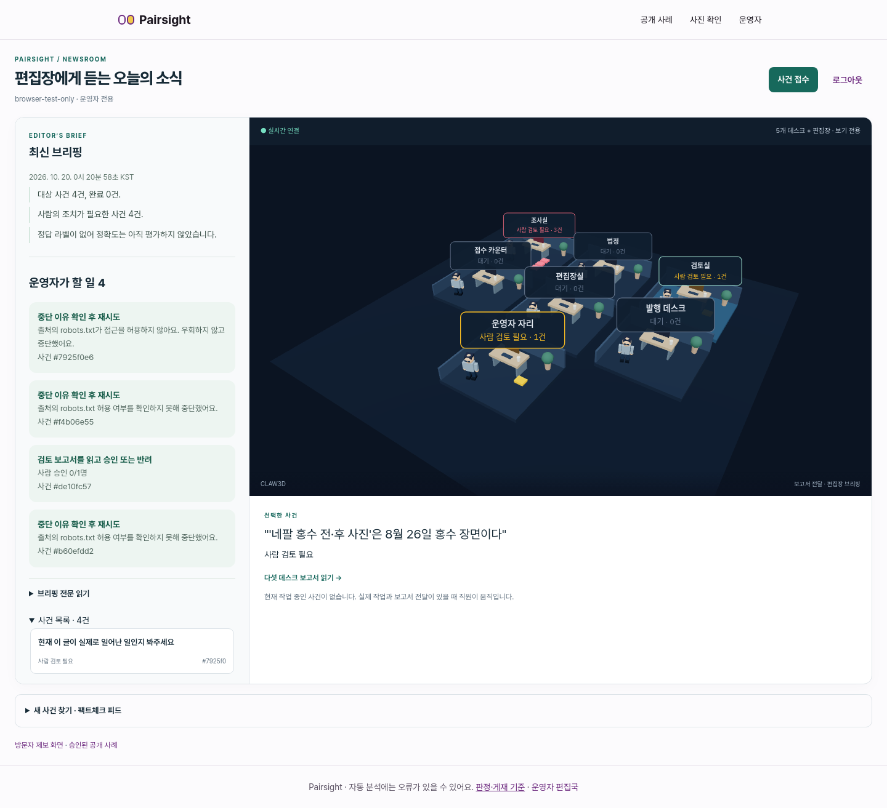
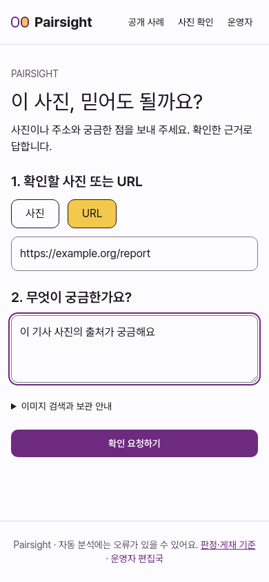

# Pairsight

**“이 사진, 믿어도 될까요?”** 사진이나 기사 URL과 궁금한 점을 보내면, 출처 후보와 이미지 비교 근거를 모아 사람이 검토하는 비영리 시범 프로젝트입니다.

> AI가 진위를 단정하는 서비스가 아닙니다. 근거가 부족하면 **판단 불가**로 남기며, 공개 게재는 운영자 승인을 거칩니다.

## 한눈에 보는 흐름



## 화면 미리보기

### 운영자: 왼쪽은 할 일, 오른쪽은 3D 편집국



**접수 → 조사 → 판정 → 검토 → 발행**, 그리고 편집장이 사건을 정리합니다. 직원의 작업·문서 전달 동작은 실제 처리 이벤트에 연결됩니다. 3D 화면은 보기 전용입니다.

### 방문자: 두 가지만 입력

<p align="center">
  
</p>

**① 사진 또는 URL  ② 궁금한 점**을 입력하면 접수 상태와 검토 결과를 확인합니다. 위 이미지는 격리된 브라우저 검증에서 촬영한 화면이며, 운영자 화면에는 중단·승인 대기 사례가 포함되어 있습니다.

## 무엇을 하나요?

| 기능 | 현재 동작 |
|---|---|
| 후보 찾기 | 수동 링크 + Google Fact Check 한국어 검색의 기사 URL |
| 사진 비교 | pHash, 정렬·차이 히트맵, 크롭·반전·색보정, 장면·편집 국소성 관문 |
| 팩트체크 법정 | 코드가 판정하고 에이전트는 기존 근거 카드만 인용. 근거 있는 의심은 판단 불가로 낮춤 |
| 편집국 | 다섯 데스크의 Markdown 보고서 + 편집장 브리핑 + 사람 승인 |
| 공개 화면 | 운영자가 승인한 사건만 카테고리별로 노출 |

**현재 한계:** Gemini 검색 그라운딩은 URL 자동 수집·검증 용도와 약관이 충돌하여 비활성입니다. SerpApi도 비활성입니다. 다른 기관의 평가 문구는 우리 판정의 근거로 복사하지 않습니다. 실제 사건 3건 비교는 접근 제한·유포 사진 미지정으로 검증률을 측정하지 못했습니다. [현재 구현·제한](replica/candidate-discovery.md) · [측정 결과](replica/discovery-comparison.md)

## 로컬에서 시작하기

검증 환경은 **Node.js 24 + npm**입니다. 운영자 계정 등록에는 Python 3가 필요합니다.

```sh
git clone https://github.com/JUNGSEHOON-AutoML/AI-_Pairsight.git
cd AI-_Pairsight/web
npm ci
npm run dev -- --hostname 127.0.0.1
```

- 방문자 화면: `http://127.0.0.1:3000/check`
- 운영자 화면: `http://127.0.0.1:3000/newsroom` — 먼저 `python3 scripts/create-newsroom-operator.py`로 계정을 등록합니다.
- 웹 서버만 실행하면 화면과 접수가 동작합니다. **실제 처리는 별도의 워커와 LLM 설정이 필요합니다.** 기본 LLM은 로컬 Ollama이며, Fact Check 검색 키는 `web/.env.local`의 `GOOGLE_FACTCHECK_API_KEY`에 직접 설정합니다.
- **Claw3D는 별도 앱이며 이 저장소에 포함되지 않습니다.** 수정된 별도 Claw3D checkout을 준비한 환경에서 통합 런처를 사용합니다. [데스크·3D 실행 인수인계](replica/handoff-five-desks.md) · [최신 인수인계](replica/handoff-candidate-discovery.md)

## 폴더 안내

| 디렉터리 | 내용 |
|---|---|
| [`web/`](web/) | Next.js 화면·API, 판별 엔진·법정·워커, 테스트·평가 도구 |
| [`newsroom/`](newsroom/) | 데스크·편집장 지침과 보고서 형식·보호 파일 목록 |
| [`replica/`](replica/) | 설계·정책·검증 기록·화면 캡처·인수인계 |
| [`tuning/`](tuning/) | 기준값과 실험 지침. 자동 튜닝 실행은 별도 조건으로 제한 |

소스와 문서·추적 대상 이미지를 보관합니다. **비밀키, `.env.local`, 운영자 자격 정보, 비공개 사건/보고서, 업로드, 모델·빌드 캐시, `node_modules`는 올리지 않습니다.** 로컬 평가 출력과 계정 검증 캡처 등 기존 ignore 대상도 제외합니다. 이미지별 사용 출처는 [실제 사진 평가의 권리·출처](web/eval/real-photos/ATTRIBUTION.md)를 참고하세요.

## 검증

```sh
cd web
npm run typecheck
npm run lint
npm test -- --maxWorkers=1
npm run build -- --webpack
```

2026-10-20 기준 **317개 테스트 통과**. 이미지 모델은 첫 실행 시 다운로드될 수 있습니다. 이 서버에서는 Turbopack 내부 포트 생성이 제한되어 webpack 빌드로 확인했습니다. [브라우저 검증 결과](replica/discovery-browser-check.json)
