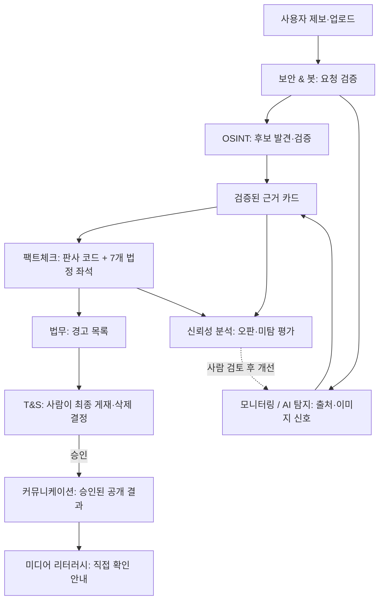
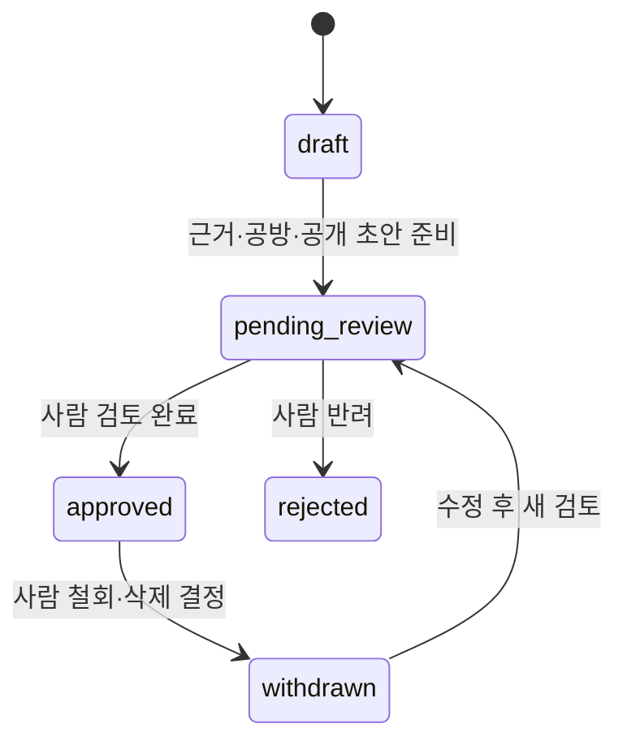

# 편집국 9개 부서와 팩트체크 법정 — 2026-10-19

## 구분과 이번 범위

**9개 부서는 업무 단위이고, 지금 관제실에 보이는 7명은 팩트체크 부서 안의 법정 좌석입니다.** 9개 부서를 9개의 자율 LLM으로 만들지 않습니다. 판사는 코드이며 법정 LLM 역할은 검사·변호인·배심원 3명·서기, 최대 6회 호출입니다.

현재 요청의 이전 지침에 맞춰 부서 운영·권한·인계 절차는 설계로 둡니다. 법정의 최소 구현과 mock 회귀 검증을 보완합니다. 별도 Claw3D의 9개 부서 구역 배치는 아직 실행하지 않았으며, 기존 법정 시연만 있습니다.

- 비영리·시범 운영. Stripe·결제·유료 요금제·유료 API 자동 전환 없음.
- 실행용 LLM 우선순위는 Ollama 로컬. 기본 시연/테스트는 mock.
- 이후 사용자 요청으로 추가한 Gemini 선택 제공자와 실측 기록은 유지합니다. 이번 부서 작업에서는 Gemini를 호출하지 않습니다. 이전 설계의 ‘무료 API는 조사만’과 이후 연결 완료 상태를 구분합니다.
- 모든 부서는 기존 파이프라인의 산출물을 인계받습니다. 새 사실을 임의로 근거 카드에 추가할 권한이 없습니다.

## 조직과 흐름

법정 좌석: 판사(규칙 v3 코드), 검사, 변호인, 배심원 1(사진 기술), 배심원 2(날짜·맥락), 배심원 3(출처 신뢰), 서기. 판사가 이미 판단 불가면 에이전트 공방을 열지 않습니다.

## 9개 부서 대응표

| 부서 / 고정 ID | 파이프라인·기존 모듈 | 담당 | 입력 | 출력 | 허용 권한 / 금지 권한 | 현재 상태 |
| --- | --- | --- | --- | --- | --- | --- |
| 모니터링 / AI 탐지 `detection` | 입력 정리·이미지 비교·EXIF/C2PA/워터마크, `verification` | 코드, 예외 검토 사람 | 업로드 또는 허용 페이지의 이미지 | 해시·비교 측정값·출처 신호 근거 카드 | 로컬 이미지 계산 허용. 픽셀 탐지만으로 판정·인터넷 상시 감시 금지 | 비교/메타데이터 구현, 일부 출처 신호 mock. 부서 작업 큐 없음 |
| OSINT `osint` | 후보 발견→요청 시 후보 페이지 검증, Providers·PolicyFetch | 코드 + 수동 후보를 확인하는 사람 | 이미지 해시·사용자 URL·발견 후보 | 검증된 후보 URL·날짜 출처·신뢰도·캡션/이미지 비교 카드 | 허용 범위의 페이지 요청만. robots·속도 제한·차단 시 중단. 웹 전체 수집·로그인/유료벽 우회 금지 | mock/수동 경로와 기존 선택 어댑터. 외부 무료 API의 운영 연결은 별도 |
| 팩트체크 `factcheck` | 기존 규칙 v3·`court`·`llm` | 코드 판사 + 도구 없는 법정 LLM + 게재 전 사람 | 근거 카드·기존 판정·주장 날짜 | 판정 유지 또는 판단 불가·검증된 인용·판결문 | 근거 카드 선택·정해진 의심 유형만. 새 근거 생성·판정 상향·도구 호출 금지 | 최소 법정·mock/Ollama/Gemini 선택 구현. 현재 3D의 7좌석이 이 부서 |
| 보안 & 봇 `security` | SSRF·입력 크기/형식·요청 속도/무료 한도·프롬프트 경계 | 코드 | 요청·업로드 메타데이터·연결 대상 | 허용/차단·정형 오류·보안 로그 | 서비스 자체 방어만. 외부 SNS 계정·댓글·행동 수집과 봇 계정 판별 금지 | 기존 가드 구현. SNS 봇 탐지는 범위 밖 |
| 법무 `legal` | 출처 이용 조건·200자/썸네일 제한·제목/판결문 위험 검토 | 규칙 기반 경고 코드(예정) + 사람 | 카드 출처·권리 기록·공개 초안·주제 | 경고 코드·검토 항목·참고 출처 | 경고만. 합법성 확정·자동 게재·자동 삭제·법률 자문 금지 | 정책/점검 문서. 경고 엔진 미구현 |
| T&S `trust_safety` | 게재 승인·피해 신고·정정/삭제 | 사람 | 최종 초안·법무 경고·콘텐츠 플래그·신고 | 승인/반려/철회 결정과 승인자·일시 | 사람 최종 결정. 정치·선거는 다른 두 검토자. 법정/관제실이 승인자를 가장하는 것 금지 | 승인 필드·DB 제약·RLS·읽기 필터 구현. 승인/신고 업무 화면 미구현 |
| 커뮤니케이션 `communications` | 공개 카드·제목·2D 재판 상세·정정 공지 | 코드 템플릿 + 사람 편집자. 서기는 법정 요약만 | 승인된 사례와 검증된 법정 기록 | 사실 문장 제목·공개 페이지·정정 안내 | 승인된 기록만 게시. 새 근거·개인정보·폐기 주장 원문 추가 금지. 자동 SNS 발신 없음 | 공개 대시보드/상세 구현. 공유 링크·정정 업무는 미연결 |
| 신뢰성 분석 `reliability` | 실제 사진 평가·반례·dev/holdout·기준값 래칫 | 코드 + 라벨링/채택을 맡는 사람 | 이용 권한 확인 사례·정답 라벨·판정/의심 기록 | 오판·미탐·판단 불가·법정 하향의 정당성 보고서 | 평가는 읽기. 변경은 분리 브랜치/검증/사람 검토. 에이전트의 라벨·규칙·holdout 수정 금지 | 평가 및 실행 가드 구현. 튜닝 루프 미실행 |
| 미디어 리터러시 `literacy` | 판정·게재 기준, 직접 확인하는 법 | 코드 템플릿 + 사람 검수 | 판결문·인용 카드·남은 한계 | 원문 비교·날짜·출처 확인 안내, 판단 불가의 의미 | 설명만. 출처 없는 교육용 사실·계정 추적·결론 상향 금지 | `/how-it-works`와 판결문 안내 구현 |

‘모니터링’은 접수된 제보의 상태 확인을 의미합니다. SNS 유포 추적이나 봇 계정 탐지, 전체 웹 크롤링은 하지 않습니다. 유포 경로는 제보 기반 태그입니다. 외부 후보 검색은 무료 사용 조건과 실제 프로젝트 한도를 확인한 어댑터만 별도 선택하며, 미연결이면 미연결로 표시합니다.

## 부서 간 인계 계약 (설계)

각 부서의 인계 기록은 `case_id`, `department_id`, `pipeline_version`, `court_version`, `evidence_ids`, 상태, 처리 시각, 정형 오류, 다음 담당만 가집니다. 근거는 카드 ID로 참조하며 전문 기사나 고해상도 원본을 복제하지 않습니다. 보관 범위는 기존 URL·날짜·해시·썸네일·200자 이내 발췌를 따릅니다.

- 검증 전 후보는 `S` 카드가 되지 않습니다. OSINT가 검증한 후보만 법정으로 넘깁니다.
- 법정은 카드가 고정된 사건 스냅샷을 읽습니다. LLM이 반환한 인용 ID·의심 종류를 검증하고, 화면 발언은 코드가 카드 요약·기록 날짜로 다시 구성합니다. 모델의 자유 문장은 채택하지 않습니다.
- 검토자가 근거나 제목을 수정하면 기존 승인 이력을 그대로 재사용하지 않고 재검토로 돌리는 설계입니다. 구현된 DB 승인 상태와 별도로 이 편집 업무 흐름은 아직 없습니다.
- 실패·무료 한도 소진·판단 불가를 성공으로 표시하지 않습니다. 미연결 부서는 ‘설계/미연결’, 사람 대기 작업은 ‘검토 대기’로 표시합니다.
- 편집국의 처리 단계와 공개 승인 상태는 다른 필드입니다. ‘법정 완료’가 곧 ‘게재 승인’이 아닙니다.

## 사람 승인과 역할 분리

- 법무는 경고를 추가하고 확인 근거를 남길 수 있습니다. `approval_status`를 바꿀 수 없습니다.
- T&S 담당자가 게재/반려/철회와 정정·삭제를 최종 승인합니다. 정치·선거는 서로 다른 사람 2명이 필요합니다. 각 주제 추가 검토는 [카테고리 정책](category-policy.md)을 따릅니다.
- 커뮤니케이션은 승인된 결과만 가져갑니다. 시연 JSON의 가상 승인자는 실제 운영 승인과 구분합니다.
- Claw3D는 읽기 전용 관찰자입니다. 부서 명칭·인물 배치가 보이더라도 판정, 근거, 검토자, 승인 상태나 에이전트 설정을 바꿀 수 없습니다. 기존 private 계정 삭제는 소유자 요청에 따른 별도 기능입니다.
- 모델의 말투가 설득력 있어도 승인 근거가 되지 않습니다. 사람은 인용된 카드가 실제로 해당 결론을 뒷받침하는지 확인합니다.

## Claw3D에 부서를 표시할 때의 설계

아직 9개 부서 배치를 구현하지 않았습니다. 현재 7명이 9개 부서 직원인 것처럼 설명하지 않습니다.

- 법정 7개 좌석은 `factcheck` 부서 안에 둡니다. 판사는 코드임을 표기합니다.
- 다른 8개 부서는 코드 처리 상태나 사람 검토 대기 상태를 표시합니다. 없는 에이전트를 활동 중으로 꾸미거나 9개 LLM을 자동 실행하지 않습니다.
- 3D 화면에서 고른 부서는 부서 이름·현재 구현 상태·담당 유형·입출력 카드·허용 권한을 읽기만 합니다. ‘승인’, ‘삭제’, ‘모델 변경’ 버튼으로 실행 경로를 만들지 않습니다.
- 현재 mock 재판의 `CourtEvent`는 법정 상태만 나타냅니다. 다른 부서가 실제 작업했다는 이벤트로 재해석하지 않습니다. 부서 전체를 실시간으로 표시하려면 별도 파이프라인/승인 이벤트 계약이 필요합니다.

## 최소 구현과 검증 경계

법정 구현은 `web/lib/court/`, 제공자 경계는 `web/lib/llm/`, mock 반례는 `web/tests/court.test.ts`입니다. ‘모든 주장을 카드 ID로 인용’만으로 문장 내용의 참을 증명할 수 없으므로 이번에는 모델 자유 문장을 버리고 기존 카드의 요약·날짜만 코드가 발언으로 표시하게 보완했습니다. 의심은 카드 측정값과 사전에 정한 유형을 함께 검증합니다. 서기는 이미 공방에 남은 주장·의심만 선택할 수 있습니다.

이는 카드 자체의 오류를 없애거나 의미적 사실 검증을 완성한 것은 아닙니다. 카드 품질은 기존 후보 검증/비교와 사람 검토가 담당합니다. 자유로운 자연어 공방보다 표현력이 제한되는 최소 구현이며, 새 사실이 발언에 섞이는 경로를 줄이기 위한 선택입니다.

남은 작업은 부서 큐·실시간 상태·법무 경고 코드·사람 승인 화면·Supabase 저장입니다. 이번에는 유료 서비스 연결, Gemini 재호출, 모델 다운로드, 공용 GPU 사용, 기준값 튜닝을 하지 않습니다.
