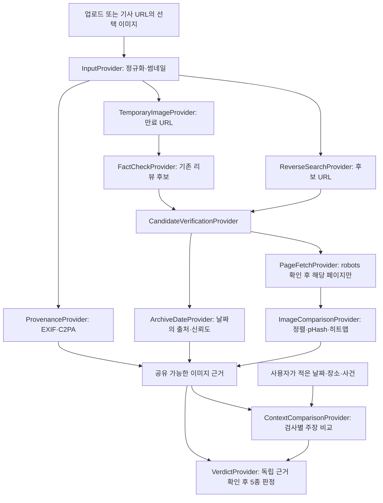

# 근거 기반 이미지 검증 파이프라인 v2

작성·공식 문서 확인일: 2026-10-19. 구현 위치: `web/lib/verification/`, 조립: `web/lib/providers/index.ts`, 실행: `web/lib/pipeline.ts`.

## 목표와 현재 구현 범위

“이 사진은 무엇이며, 어떤 근거로 유포 주장과 맞지 않는가”를 **검증한 출처 → 비교 관찰 → 판정 규칙**으로 연결한다. 가장 오래된 검색 결과를 저작자의 원본이라고 부르거나, 검색되지 않았다는 이유로 가짜라고 하지 않는다. 화면은 **원본 후보**, 날짜 출처, 부족한 근거를 구분한다. 기사 URL을 받더라도 선택한 이미지와 사용자가 적은 주장만 검사하며, 기사 전체의 사실 여부를 보증하지 않는다.

이번 구현은 외부 검색·팩트체크·아카이브·C2PA·LLM을 mock 제공자로 연결했다. HTML 추출, robots/속도 제한 정책, 썸네일 생성, EXIF 유무 확인, pHash, 이미지 정렬·차이 영역·히트맵은 실제 코드다. 모의 C2PA는 유효 서명이 있다고 **가정한 fixture**이며 실제 파일의 서명을 검증한 결과가 아니다. 일반 사용자 이미지에 대해 실서비스 수준의 판별 능력을 제공하는 단계가 아니다.

`PAIRSIGHT_PROVIDERS=mock`만 실행 가능하다. 모의 기사 도메인 외 URL은 차단하며, 기존 mock 모드의 실제 HTTP fallback을 제거했다. Supabase, Google/TinEye, Wayback, Firecrawl, LLM에 실제 요청하거나 프로젝트·키·계정을 만들지 않았다.



## 1. Provider 경계와 데이터 흐름

실제 타입은 `web/lib/verification/types.ts`, `ReverseSearchProvider`는 `web/lib/providers/types.ts`에 있다. 오케스트레이터는 공급자 이름에 의존하지 않는다.

| 단계 | 인터페이스·입출력 | 현재 동작 / 실제 연결 시 조건 |
| --- | --- | --- |
| 입력 정리 | `InputProvider.normalize(RawInput, signal) → NormalizedInput` | 파일 형식·10MB 제한, 2천만 픽셀 디코딩 제한, 자동 방향 보정, SHA-256, 최대 512px 썸네일. 기사 URL이면 해당 페이지 1개의 제목·게시일·대표/본문 이미지·캡션 추출 및 선택 이미지 소속 확인. |
| 후보 발견 | `ReverseSearchProvider.search(ImageInput, signal) → candidates[]` | TinEye 또는 Google Vision 계약 미확정. 후보 URL·공급자·발견일·이미지 URL만 반환. 검색 순위나 유사도만으로 “원본 확인” 처리 금지. |
| 팩트체크 발견 | `FactCheckProvider.search(imageUri, signal) → FactCheckRecord[]` | Google `claims:imageSearch` 형식의 mock. 기존 주장·평가·기관·리뷰 URL 반환. 임의의 평가 문구를 자동으로 ‘거짓’으로 번역하지 않는다. 실어댑터는 기본 `assessment=unknown`; 평가 분류와 주장 범위의 검증 규칙이 있어야 승격 가능. |
| 임시 이미지 전달 | `TemporaryImageProvider.publish(image, signal) → {url, expiresAt, revoke}` | 현재는 네트워크에서 접근 불가능한 mock URL과 메모리 썸네일. 성공·실패 모두 `finally`에서 회수. |
| 후보 검증 | `CandidateVerificationProvider.verify(candidate, signal)` | 해당 후보 페이지를 요청 시점에 가져와 메타데이터·캡션·대표/본문 이미지를 확인. 후보당 이미지 최대 2개. 페이지 실패 후 아카이브로 본문을 대신 읽는 우회는 하지 않는다. |
| 페이지 접근 | `PageFetchProvider.page / image` | `PolicyFetch`의 robots·상태 코드·리다이렉트·속도 제한·SSRF 검사. mock transport도 같은 정책과 HTML 파서를 통과한다. |
| 과거 기록 | `ArchiveDateProvider.firstCapture(url, signal) → DateRecord|null` | 현재는 정해진 모의 아카이브. 실제는 URL 하나의 정확 일치 CDX 조회를 별도 검토한다. Availability 응답을 최초 저장일로 사용하지 않는다. |
| 이미지 비교 | `ImageComparisonProvider.compare(input, reference, signal)` | 실제 pHash·정렬·반전·잘라내기·색보정·영역 차이·128px 히트맵. |
| 출처 기록 | `ProvenanceProvider.inspect(image, signal) → Evidence[]` | 실제 EXIF 유무 확인 + 모의 C2PA 등. EXIF/GPS 원문 저장 안 함. 실제 C2PA SDK·신뢰 루트·인증서 상태 확인은 미구현. |
| 맥락 비교 | `ContextComparisonProvider.compare({claim,sources,factChecks}, signal)` | 현재 모의 LLM이 날짜·장소·사건 불일치 관찰을 반환. 실제 모델·키는 연결하지 않음. |
| 판정 | `VerdictProvider.decide(VerdictInput) → VerdictResult` | 순수한 v2 규칙. 근거·이유·부족한 사항 반환. LLM이 최종 판정을 작성하거나 바꾸지 않음. |

### 기사 URL의 처리 범위

`og:image` / `twitter:image`를 대표 이미지, `article`·`main`·`figure`의 `img`를 본문 이미지로 추출한다. 목록은 최대 12개다. 게시일은 `article:published_time`, `datePublished` 및 Article 계열 JSON-LD를 사용한다. `dateModified`를 게시일로 대체하지 않는다. 제목·캡션은 추출하되 저장할 출처 텍스트는 페이지별 합계 200자 이내로 투영한다. 원문 HTML·기사 전문은 보관하지 않는다.

페이지 링크·사이트맵을 따라가지 않는다. 사용자가 URL에서 이미지 목록을 여는 요청과, 선택 후 검사를 시작하는 요청은 별도이므로 같은 기사 URL을 다시 읽을 수 있다. 이는 다른 페이지의 발견이나 크롤링이 아니다. 실제 배포에서는 같은 사용자 요청 묶음의 추출 결과를 짧게 재사용할 수 있으나 전문 캐시는 만들지 않는다.

### Google imageSearch와 임시 서명 URL

실제 연결 시 Supabase **비공개 버킷**에 메타데이터를 제거한 썸네일만 넣고, 초기 설계값 5분의 서명 URL을 발급한다. Google이 인증 헤더 없이 HTTPS로 읽을 수 있어야 한다. `imageUri`에는 이 URL을 전달한다. 이미지의 공개 URL이 이미 있더라도 외부 변경·차단·개인정보 노출을 줄이기 위해 동일한 임시 전달 경로를 기본으로 삼는다.

호출이 끝나면 객체 삭제를 `finally`에서 시도하고, 프로세스 중단에 대비한 수명 정리 작업을 추가해야 한다. URL 만료는 객체 삭제와 다르다. 서명 URL·서명 토큰·버킷 객체 경로를 근거, 검사 기록, 로그, LLM 입력에 남기지 않는다. 원본 SHA-256과 전달한 썸네일 해시는 구분한다. 5분은 우리 설계값이며 Google이 보장한 다운로드 완료 시간이나 Supabase 기본값이 아니다. 외부 전송 동의·사용 권한과 공급자 보관 정책 확인은 실제 연결 전 조건이다.

## 2. 후보 검증과 날짜의 의미

선택 우선순위는 **페이지 게시 메타데이터 → 확인 가능한 가장 이른 Wayback 저장일 → 검색 API 발견일**이다. 우선순위는 표시 기준이며 날짜가 참이라는 보증이 아니다. 각 관찰을 모두 남긴다.

```ts
type DateRecord = {
  value: string;
  source: "page_meta" | "wayback_first_capture" | "search_discovered";
  sourceUrl: string;
  confidence: "medium" | "weak";
  meaning: "publication_claim" | "page_capture" | "image_discovery";
  imageBound: boolean;
  imageHash?: string;
};
```

- 페이지 메타데이터는 사이트가 적은 게시일이다. 수정·이전·재발행 가능성이 있어 신뢰도 중 이하이며, 현재 이미지가 그 날짜에 있었다는 증거는 아니다.
- Wayback 저장일도 최초 게시일이 아니다. 특정 URL에서 조회 가능한 가장 이른 정상 저장본이라는 범위만 뜻한다. 실제 어댑터는 정확 URL의 CDX 첫 정상 레코드와 스냅샷 상태를 확인한다. 누락·삭제·robots·접근 제한으로 과거 기록을 확인할 수 없으면 날짜 없음으로 처리한다.
- 과거 스냅샷에 **비교한 이미지가 있었음**까지 검증한 경우에만 `imageBound=true`와 그 이미지 해시를 반환한다. 엔진은 비교한 후보 이미지의 SHA-256과 `imageHash`가 같아야 이를 채택한다. 페이지 저장일만 받아서 이미지 존재를 추정하지 않는다.
- 검색 발견일은 검색 엔진이 발견한 시점이며 약한 근거다. 별도의 검증된 과거 이미지 바인딩이 없으면 날짜 단독 결론에 사용하지 않는다.
- 날짜 형식·미래 날짜를 검사한다. 게시일보다 이른 아카이브/발견 기록, 상충하는 게시일이 있으면 `dateDisputed=true`로 표시하고 날짜만으로 판정하지 않는다. 선택한 날짜를 과거로 조용히 바꾸지 않는다.

가장 이른 검증 후보에 붙는 `isEarliest`는 **이번 요청에서 찾은 후보 집합 안에서**의 표시다. 저작권자·촬영자·최초 배포자 확인과는 다르다.

## 3. 실제 이미지 비교와 증거 강도

`LocalImageComparisonProvider`는 원본 바이트를 메모리에서만 다룬다. 입력/후보를 같은 작은 격자로 정규화한 후 다음을 수행한다.

1. 32×32 명도 DCT의 저주파 8×8로 pHash를 만들고 해밍 거리를 기록한다. 64개 자리 중 DC 자리는 고정하며 나머지 63개를 비교한다.
2. 수평·수직 반전, 축에 평행한 잘라내기와 리사이즈를 한정된 격자로 탐색한다. 정렬 점수는 명도 상관도이며 진위 확률이 아니다. 평탄하거나 정보량이 부족한 이미지는 정렬을 기각한다.
3. 정렬 후 pHash 거리와 상관도를 함께 검사한다. 현재 실험 임계값은 상관도 ≥0.9, 정렬 후 해밍 거리 ≤18이다. 운영 정확도로 보정된 기준이 아니다.
4. 전역 색상 변화가 높은 상관도를 유지하고 선형 색상 정규화로 오차가 충분히 줄어드는 경우 색보정으로 기록한다. 이를 악의적 조작이라고 부르지 않는다.
5. 정렬 후 남은 픽셀 차이를 16×16 격자로 집계해 연결 영역 최대 8개와 128×128 PNG 히트맵을 만든다. 영역은 입력 이미지 좌표계다. 화면의 좌우/슬라이더 비교는 원래 썸네일이고 히트맵이 정렬 후 결과다.
6. EXIF 존재는 약한 관찰이다. C2PA는 유효 서명, 서명 주체 신뢰, 해시 바인딩, 편집/생성 action을 실제 검증해야 강한 근거가 될 수 있다. 출처 기록이 없다는 사실은 가짜의 증거가 아니다.

잘라내기·반전·색보정은 변환 관찰이며 자동 ‘편집 조작’ 판정 사유가 아니다. 국소 차이만 발견된 경우도 근거 강도 중 이하로 둔다. 생성/편집 의도를 이미지 차이로 추정하지 않는다. 실제 C2PA 통합 전까지 강한 출처 증거는 명시된 mock fixture에서만 재현된다.

현재 정렬은 약 50% 이상 남은 축 정렬 crop 후보와 정해진 위치 격자만 탐색한다. 원근 변화, 임의 각도 회전, 작은 crop, 복잡한 콜라주, 교묘한 합성, 의미상 비슷한 별개 사진은 보장하지 않는다. 해상도 축소로 작은 편집이 사라질 수 있다. 실제 보도 사진·공격 사례·오탐/미탐 평가셋 검증 없이 정확도 수치를 홍보하지 않는다.

## 4. 맥락 비교: LLM의 역할과 한계

사용자에게 유포 주장(최대 200자)과 들은 촬영 날짜를 선택적으로 받는다. 기사 게시일을 사용자가 주장한 사건 날짜로 자동 설정하지 않는다. 이미지 없이 기사 텍스트 전체의 진위 판정을 하지는 않는다.

실제 LLM 어댑터는 검증한 이미지 후보의 URL·짧은 캡션/발췌와 사용자 주장을 **데이터**로 전달하고, 날짜·장소·사건별 `match / mismatch / unknown`, 인용 URL, 인용 부분, 짧은 설명만 JSON 스키마로 받는다. 페이지에 있는 명령, 역할 변경, 도구 호출 지시를 실행하지 않도록 도구 없는 분석 호출로 설계한다.

현재 엔진은 반환 URL이 전달한 검증 출처에 있는지, 인용이 그 발췌의 실제 부분 문자열인지 확인한다. 만들어낸 URL/인용은 폐기하고 강도는 중 이하로 강제한다. 이 확인도 LLM 해석의 진실성을 보증하지는 않는다. LLM 불일치 관찰만으로 맥락 조작 판정을 내리지 않는다. 타임아웃은 ‘맥락 비교 확인 못 함’으로 표시한다.

기존 팩트체크도 별개다. 검색에서 찾았다는 사실만으로 현재 주장이 거짓이라고 할 수 없다. 이미지 실비교 + 후보 원문의 ClaimReview 기관/평가/주장 일치 + 현재 사용자 주장 일치가 필요하다. 이번 mock에서는 공백·유니코드 정규화 후 정확히 같은 주장만 채택한다. 긴 주장이 잘려 저장된 경우는 자동 일치를 금지한다. 실제 어댑터의 동의어·의역 매칭은 별도 검증이 필요하다.

## 5. 기존 5종 판정에 연결한 규칙 v2

| 판정 | 필요한 근거 | 이것만으로는 부족 |
| --- | --- | --- |
| 진짜 확인 | 유효한 카메라 촬영·무편집 출처 기록. 충돌하는 차이/맥락 관찰이 없어야 함 | 오래된 같은 이미지, 낮은 AI 점수, EXIF 존재. 별도 유포 주장·날짜가 있으면 이 규칙만으로 주장의 진실을 보증하지 않음 |
| AI 생성 | 검증된 생성 출처 기록 또는 검증된 알려진 생성 워터마크 | LLM의 시각적 느낌, 픽셀 탐지 점수, 검색 결과 없음 |
| 편집 조작 | 검증된 AI 편집 출처 기록. 국소 차이와 히트맵은 보조 설명 | crop·반전·색보정·차이 영역만 발견됨. 픽셀 편집 단독 확정 규칙은 보류 |
| 맥락 조작 | 같은 이미지·같은 주장에 대한 검증된 팩트체크, 또는 해당 이미지가 주장한 촬영 날짜 전에 존재했음을 확인한 비충돌 기록 | 현재 페이지의 오래된 게시일, LLM 단독 해석, 다른 주장에 대한 팩트체크 |
| 판단 불가 | 위 조건 미달, 강한 출처 기록 충돌, 불완전한 확인 | 강제로 이분법 ‘진짜/가짜’ 선택하지 않음 |

AI 생성 여부와 기사 속 사건 주장의 진실성은 별개다. 현재 한 개 대표 판정의 우선순위는 강한 출처 간 충돌 → AI 생성 → AI 편집 → 맥락 조작 → 촬영 출처 확인 → 판단 불가다. 복수 축이 동시에 확인되어도 나머지 근거 카드와 맥락 관찰은 숨기지 않는다.

설명 예시(mock): “원본 후보의 캡션은 2019년 부산 시장 행사다. 사용자의 주장은 2026년 서울 홍수다. 같은 이미지·같은 주장을 다룬 팩트체크 원문을 확인했으므로 맥락 조작이다.” 날짜·장소 불일치의 LLM 관찰과, 실제 판정을 허용한 독립 팩트체크 근거를 별도 카드로 제시한다.

`Analysis`에는 이미지별 공통 근거만 넣는다. `Check`의 `claimText`, `claimedDate`, `contextStatus`, `contextEvidence`는 사용자별 검사에 붙는다. 같은 이미지로 서로 다른 주장을 검사해도 공유 결과를 덮어쓰지 않는다. 캐시된 분석을 재사용해도 해당 검사의 맥락 비교를 마쳐야 결과 화면이 완료된다.

## 5-1. 규칙 v3: 신뢰 출처 (2026-10-19)

**문제:** SNS로 퍼진 이미지는 대부분 메타데이터(C2PA·EXIF)가 지워져 있습니다. 그래서 v2에서는 원본 비교와 히트맵이 아무 판정으로도 이어지지 않았습니다. v3는 **신뢰 출처 목록**([trusted-sources.md](trusted-sources.md))에 있는 페이지에 한해, 실제로 가져와 비교한 결과와 페이지 게시일을 판정 근거로 씁니다. 목록에 없는 출처는 v2 그대로입니다. 목록이 비어 있으면 결과가 v2와 정확히 같습니다(테스트로 확인).

| 판정 (규칙 id) | 모두 만족해야 함 | 강도 |
| --- | --- | --- |
| 편집 조작 (`v3.trusted_edited`) | ① 후보의 최종 URL이 신뢰 출처 ② 페이지를 실제로 가져왔고 이미지 비교 통과: 정렬 상관도 ≥0.9, 정렬 후 pHash 거리 ≤18 ③ 국소 차이: 차이 영역 ≥1개, 변화 비율 ≤0.25 (작은 편집은 변화 비율이 2% 미만이어도 차이 영역이 남으므로 비율 하한을 두지 않음) ④ 게시일 또는 보관 기록 날짜가 있고 날짜 충돌(`dateDisputed`) 없음. 검색 발견일만 있으면 안 됨 ⑤ 업로드 이미지와 같은 사본 중 어느 것도 신뢰 출처보다 이르거나 같은 날짜가 아님. 이 판단에는 검색 발견일도 포함 | 중. 더 늦게 게시된 같은 사본이 있거나, 비교한 이미지가 보관 기록에서 확인되면 강 |
| 맥락 조작 (`v3.trusted_context`) | ① 신뢰 출처 ② 이미지 비교 통과 + 같은 사진(차이 영역 0개 **그리고** 변화 비율 <0.02) ③ 게시일 또는 보관 기록 날짜, 날짜 충돌 없음 ④ 사용자가 알려준 날짜보다 **30일 이상** 이름 | 중. 비교한 이미지가 보관 기록에서 확인되면 강 |

- **우선순위:** 출처 기록 충돌 → AI 생성 → AI 편집(C2PA) → 팩트체크 → 이미지 바인딩 날짜(v2) → **v3 편집 조작 → v3 맥락 조작** → 진짜 확인 → 판단 불가.
- **"같은 사진"의 정의 (v2·v3 공통):** 정렬 후 변화 비율 2% 미만 **그리고** 차이 영역 0개. v2의 보관 기록 날짜 규칙과 팩트체크 이미지 일치 확인에도 같은 정의를 씁니다. 작은 편집은 변화 비율이 2% 미만이어도 차이 영역이 남기 때문입니다.
- **충돌:** 서명된 카메라 촬영·무편집 C2PA가 있는데 신뢰 출처와 다르면 판단 불가(`v3.capture_vs_trusted_conflict`)로 둡니다.
- **v2 원칙과의 관계:** v2의 "현재 페이지의 오래된 게시일만으로는 부족" 원칙은 **신뢰 출처에 한해** 완화했습니다. 대신 그 페이지에 현재 같은 사진이 실제로 있는지 이미지 비교로 확인해야 하고, 30일 여유와 날짜 충돌 검사를 둡니다. 신뢰 출처가 사진을 나중에 교체하거나 게시일을 고친 경우는 이 규칙이 틀릴 수 있습니다. 평가셋으로 측정해야 하는 부분입니다.
- **문구:** "신뢰 출처 원본과 다름"처럼 관찰만 말하고, 누가 왜 바꿨는지는 판단하지 않습니다.
- **핵심 발견(`headlineFinding`):** 판정과 따로, 가장 강한 관찰 하나를 출처·날짜와 함께 판정 결과에 담습니다. 판단 불가 화면에서는 "단, …"으로 맨 위에 보입니다.
- **임계값:** `TRUSTED_RULES`(`web/lib/verdict.ts`)에 있습니다. 합성 fixture에서만 확인한 실험값이며, 실제 사례 평가([eval/README.md](../web/eval/README.md))로 조정해야 합니다.

## 6. 접근 정책·저장 최소화·실패 처리

- 웹 전체 크롤링, 사이트맵 순회, 자체 이미지 색인을 만들지 않는다. 외부 검색 결과를 요청당 후보 최대 5개로 중복 제거한다. 팩트체크도 최대 5건, 후보당 이미지 최대 2개만 확인한다. URL 단위 접근에 필요한 robots 조회와 리다이렉트는 별도 안전 검사이며 링크 발견이 아니다.
- 실 HTTP 어댑터는 출처별 동시 요청 1개, 시작 간격 기본 1초, robots `Crawl-delay` 중 큰 값을 적용한다. 이는 서비스 공식 quota가 아닌 우리 제한이다. mock transport만 0ms로 테스트한다.
- robots는 출처별 1시간 메모리 캐시. 404/410은 규칙 없음으로 취급하고, 접근 거부/서버 오류/HTML challenge/해석할 수 없는 상태는 보수적으로 중단한다. robots 리다이렉트는 같은 출처만 허용한다.
- 모든 페이지/이미지 리다이렉트(최대 3회)의 목적지를 다시 검사한다. 403/429/503에 다른 프록시·브라우저 신분으로 재시도하지 않는다. 429/503은 `Retry-After`와 최소 60초 중 큰 시간 동안 출처를 쉬게 한다. 유료벽·봇 확인 페이지·비공개 콘텐츠는 ‘확인 못 함’이다. JS만으로 렌더링되는 본문은 현재 어댑터로 확인 못 할 수 있다.
- 요청 및 연결 시점 DNS/IP 검사로 내부망·loopback·메타데이터 주소와 DNS rebinding을 차단한다. HTTP(S), 80/443만 허용. 쿠키·로그인·사용자 비밀 헤더를 전달하지 않는다. `nosnippet`/`noarchive`는 보수적으로 보관 금지로 처리한다.
- 원본 이미지 입력 10MB, 페이지 HTML 파싱 2MB, 이미지 디코딩 2천만 픽셀 제한. 네트워크 수신의 공통 하드 캡은 10MB다. 분석·맥락 호출은 각각 30초 예산. 실제 배포에는 작업 큐, 전체 작업 동시성 및 사용자별 요청 제한이 추가되어야 한다.
- **영속 보관 허용:** URL, 날짜와 출처/신뢰도, SHA-256/pHash 등 해시·파생 비교 수치, 최대 512px 썸네일, 128px 히트맵, 근거 종류/상태, 페이지별 200 유니코드 문자 이내 출처 발췌. 팩트체크 기관·평가·주장은 한 페이지의 200자 예산 안에서 분할하며 인용 카드는 같은 발췌의 부분 문자열만 참조한다. 사용자 입력 주장도 200자 제한이다. 기존 계정 식별자·한도 등의 운영 데이터와 외부 콘텐츠 저장 정책은 구분한다.
- **금지:** HTML/기사 전문/고해상도 원본을 DB·디스크·로그·캐시에 보관, EXIF/GPS 원문 보관, 임시 서명 토큰 보관, 외부 서비스에 장기 색인을 구축하도록 요청. 입력 원본과 후보 원본 바이트는 처리 중 메모리에만 존재하고 완료 후 참조를 놓는다. 메모리의 즉시 영점 소거를 보장하지는 않는다.
- 새 검사의 `.data/uploads`에는 썸네일만 저장한다. 과거 버전이 남긴 사용자 파일은 자동 삭제하지 않았다. 기존 운영 데이터가 있다면 별도 동의된 정리·마이그레이션이 필요하다. 원본을 보관하지 않으므로 재검사는 썸네일 기반이며 C2PA/EXIF 재검증을 건너뛰고 제한을 표시한다. 전체 검사에는 원본을 다시 업로드해야 한다.
- 한 검색 서비스가 실패하면 부분 결과와 경고를 보여준다. 역이미지 검색 실패와 비어 있는 팩트체크만으로 ‘원본 없음’이라고 하지 않는다. 후보 검증을 못 끝낸 경우도 ‘원본 확인 미완료’로 구분한다. 분석 자체 실패 시 무료 횟수를 환불한다.

최대 200자와 작은 썸네일은 데이터 최소화 기준이며, 모든 사이트에 대한 복제·상업 이용 권한을 자동으로 부여하지 않는다. 실제 공급자 계약과 출처별 표시·보관 권한에 따라 저장을 더 줄이거나 링크만 남겨야 한다.

## 7. 요청한 외부 서비스 확인 결과

아래는 2026-10-19에 확인한 문서의 내용과 미확인 사항이다. 서비스 연결·결제·키 생성은 수행하지 않았다.

### Google Fact Check Tools API

`GET /v1alpha1/claims:imageSearch`는 공개 접근 가능한 HTTP(S) 이미지 URI가 필요하며, 응답 페이지 크기의 기본값은 10이다. **이 10은 호출 quota가 아니다.** 이미지 호스팅 서버의 접근 제한 등으로 가져오기에 실패할 수 있다. [공식 imageSearch 참조](https://developers.google.com/fact-check/tools/api/reference/rest/v1alpha1/claims/imageSearch)

Claim Search는 API 키가 필요하다. 읽기/쓰기 API의 Data Commons 고지와 검색 API의 조건을 혼동하지 않는다. 검색 API에는 일반 Google API 약관이 적용된다. [시작 문서](https://developers.google.com/fact-check/tools/api), [Fact Check API 약관](https://developers.google.com/fact-check/tools/api/terms)

확인한 공개 참조/가이드/약관에서 분당·일일 호출 수의 확정값을 찾지 못했다. Google 약관은 접근 한도를 Google이 정하고 우회하지 못하도록 한다. **실제 프로젝트의 Cloud Console 할당량 확인이 필요하며 현재 숫자는 미확인**이다. 제3자 콘텐츠의 권리·표시·복제 제한, 캐시 헤더를 넘는 보관 제한 등도 적용된다. 원문 링크와 기관을 표시하되 재배포·영구 캐시가 허용된다고 가정하지 않는다. [Google API 이용약관, 특히 §2(d), §5](https://developers.google.com/terms)

### Wayback Machine Availability API

Availability는 URL의 접근 가능한 스냅샷 **하나**를 반환한다. timestamp를 주면 가까운 저장본, 생략하면 최근 저장본이 대상이다. 최초 저장일을 반환하는 전용 API가 아니므로 이를 `wayback_first_capture`에 바로 매핑하면 안 된다. [공식 Availability 문서](https://archive.org/help/wayback_api.php)

URL 하나의 정확 일치 CDX 조회에서 시간순 첫 정상 응답을 확인하는 대안을 설계했다. 도메인 전체 조회·와일드카드·자체 인덱싱은 하지 않는다. 이 대안의 실제 호출과 스냅샷 이미지 검증도 아직 구현하지 않았다. [Internet Archive 공식 CDX 서버 문서](https://github.com/internetarchive/wayback/tree/master/wayback-cdx-server)

현재 공식 약관 페이지는 웹 컴포넌트라 일반 텍스트 추출이 비었으며, 일반 Chrome의 공개 렌더링 화면에서 본문을 확인했다(표기된 Terms of Use 날짜 2014-12-31). 컬렉션 접근을 학술·연구 목적으로 제한하고, 서비스/자원 방해 금지, 관련 법·저작권·개인정보 준수, 콘텐츠 정확성 및 지속 가용성 비보장을 명시한다. **상용 검증 앱에서의 API 메타데이터 사용·컬렉션 접근까지 허용된다고 단정할 수 없으므로 실제 채택 전 사용 범위 확인이 필요하다.** 연락이나 허가 요청은 하지 않았다. [Internet Archive 공식 약관](https://archive.org/about/terms)

Availability의 공식 숫자 호출 한도·보장 SLA는 확인한 공개 문서에서 찾지 못했다. 인터넷에서 제시되는 분당 숫자를 공식 quota로 인용하지 않는다. 향후 초기 자체 제한은 동시 1, 초당 최대 1회 및 429 후 중단으로 제안하며, 이는 허용량 보장이 아니다. 가용성이 떨어지면 날짜 근거를 빼고 판단 불가/부분 결과로 종료한다.

### Firecrawl 후보 페이지 fetch

`crawl` 문서는 robots를 기본 준수하며 Enterprise의 `ignoreRobotsTxt`/`robotsUserAgent` 옵션을 설명한다. 기본 `ignoreRobotsTxt=false`지만 **이것은 crawl 설정**이다. 이번 원칙상 재귀 crawl은 사용하지 않는다. [공식 Crawl 문서](https://docs.firecrawl.dev/features/crawl)

단일 페이지 `/scrape`의 공개 요청 스키마에는 이에 대응하는 robots 준수 설정을 확인하지 못했다. 따라서 “Firecrawl에서 robots 옵션 하나를 켜면 단일 fetch도 정책을 만족한다”고 결론 내릴 수 없다. `storeInCache`는 기본 true여서 향후 사용 시 false가 필요하고, 별도 보관·로그 정책도 확인해야 한다. [공식 Scrape API](https://docs.firecrawl.dev/api-reference/endpoint/scrape)

Enhanced mode 문서는 실패 시 자동으로 강화된 접근을 재시도하는 동작을 설명한다. 이 기본 동작을 그대로 쓰면 봇 차단 우회 금지 원칙과 충돌할 수 있다. **현재는 미채택**이다. 검토를 재개하려면 독립 robots/속도/리다이렉트 검사, 차단 시 즉시 중단, 자동 enhanced/proxy 전환 비활성화 보장, `storeInCache=false`, 원문 저장·로그 미보관 조건을 단일 scrape에 대해 공급자가 보장하는지 확인해야 한다. 단순한 `basic` 설정만으로 모든 내부 동작을 보장한다고 가정하지 않는다. [공식 Enhanced mode](https://docs.firecrawl.dev/features/enhanced-mode)

## 8. Fixture와 검증

이미지들은 기존 프로젝트에서 직접 그린 장면이며 제3자 기사를 복제하지 않았다. `scripts/make-comparison-fixtures.mjs`는 그 장면에서 실제 PNG/JPEG 쌍을 만든다. 테스트는 미리 정한 유사도 숫자를 읽는 방식이 아니라 파일 바이트를 실제 비교한다. 합성 fixture의 통과는 실제 뉴스 사진에 대한 탐지 정확도 검증이 아니다.

| fixture | 예상 결과 / 확인 대상 |
| --- | --- |
| authentic | 진짜 확인: 모의 유효 카메라 C2PA + 실제 동일 이미지 |
| ai_generated | AI 생성: 모의 생성 C2PA, 원본 후보 없음 |
| edited | 편집 조작: 모의 편집 C2PA + 실제 달라진 픽셀 영역 |
| miscontextualized | `이 사진은 2026년 서울 홍수 현장이다.` 주장과 함께 검사 → 검증된 기존 리뷰/이미지 일치로 맥락 조작 |
| inconclusive | 확정 가능한 출처 기록 없음 → 판단 불가 |
| no_source | 후보 없음 → 판단 불가 + 원본 없음 |
| fact_check_found | 관련 리뷰·이미지 확인, 현재 주장 없음 → 판단 불가 + 기존 팩트체크 카드 |
| trusted_edited | (v3) C2PA 없음 + 가상 신뢰 출처 `wire.example.test`의 2021년 페이지와 실제 국소 차이 → v2 판단 불가, v3 편집 조작(중) |
| trusted_context | (v3) C2PA 없음 + 같은 사진이 가상 신뢰 출처에 2018년 게시, 알려준 날짜 2026-10-01 → v2 판단 불가, v3 맥락 조작(중) |
| provider_timeout | 후보 발견 실패 → 실패 상태 + 횟수 환불 |

이미지 단위 검증: 원본, 사각 영역 편집, 잘라내기, 좌우 반전, 색보정, 축소/JPEG, 무관한 이미지, 단색 이미지. 추가 검증: robots 금지/오류, 리다이렉트 대상 정책, private IP, 속도·동시성·429 cooldown, 유료벽, 본문 링크 미순회, EXIF 제거·썸네일 크기·200자 한도, 임시 URL 회수, LLM 인용 조작 거부·강도 제한, 주장별 격리와 재검사 제한.

실행:

```sh
cd ~/ai-verify/web
PATH=$HOME/.local/node/bin:$PATH PAIRSIGHT_MOCK_DELAY_MS=0 npm test
PATH=$HOME/.local/node/bin:$PATH npm run typecheck
PATH=$HOME/.local/node/bin:$PATH npm run lint
PATH=$HOME/.local/node/bin:$PATH npm run build
PATH=$HOME/.local/node/bin:$PATH npm run dev
```

샘플 화면: `http://127.0.0.1:3000/dev/fixtures`. 모의 외부 API는 키 없이 동작한다. 테스트/브라우저 최종 결과는 `replica/build-log.md`의 v2 기록에 남긴다.

## 9. Supabase 연결 전 남은 작업

1. 실제 역이미지 검색 공급자의 상업 이용·썸네일 표시·캐시 권한과 한국 언론 커버리지 확정.
2. Google 프로젝트 실제 quota, 기관별 ClaimReview 평가 해석, 임시 이미지 전송·보관 조건 확인.
3. Wayback 사용 목적·조건 확인 및 CDX 정확 URL 조회와 과거 이미지 바인딩 어댑터 구현. 허용 조건이 충족되지 않으면 선택적인 날짜 근거로 제외.
4. 실제 C2PA 검증기·신뢰 루트 정책 및 평가셋 구축. LLM은 인용 스키마와 회귀 평가를 갖춘 어댑터로 교체.
5. 영속 DB에는 이번 `Analysis.verification`, `SourceMatch.dates/comparison`, 검사별 `claimText/contextStatus/contextEvidence`, 새 evidence kind를 반영한 **별도 스키마 변경과 RLS 검증** 필요. 이번에는 DB 연결이나 기존 SQL에 대한 새 마이그레이션 적용을 하지 않았다.
6. 실서비스 작업 큐·멱등성·입력 요청 제한·일시 파일/임시 버킷 정리·사용자 삭제 및 공유 근거 보관 기간·출처 삭제 요청 처리. 현재 memory store/프로세스 내 작업은 개발용이다.
